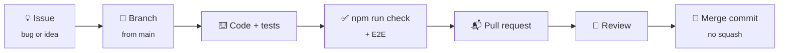
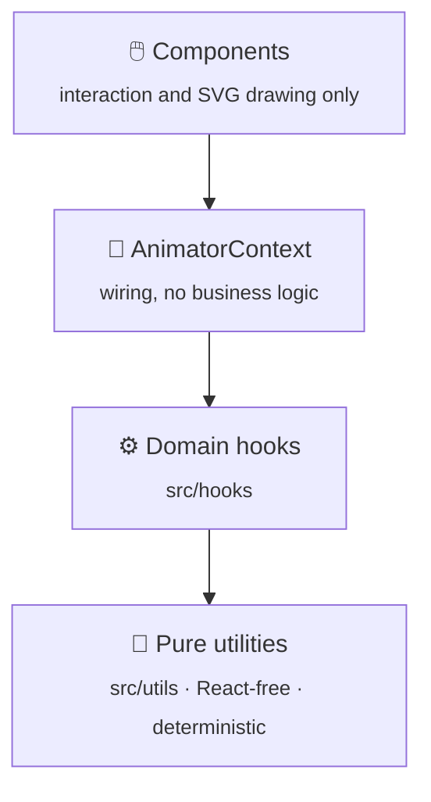

# 🤝 Contributing to Keyframe Character Studio

Thanks for helping! This page is short on purpose. The full engineering rules live in [`AGENTS.md`](AGENTS.md).

## 🔄 The flow

1. **Open or pick an issue** and describe the problem a user sees.
2. **Branch from `main`**, named after the kind of change and the area it touches, for example:
   - `feature/timeline/onion-skin`
   - `bugfix/masks/hole-not-cut`
   - `docs/readme`
3. **Change the smallest thing that solves it**, with tests.
4. **Validate** (see below) and open a pull request using the template.
5. PRs are merged with **"Create a merge commit"**, so every commit keeps its author and date.

## 🏛️ Architecture in one picture

- New behaviour goes **pure helper → domain hook → thin wiring → minimal UI**.
- One authority per job: no second animation engine, playback clock, serializer or clipboard.
- `Track.channels` is the canonical animation data. Legacy `Track.keyframes` is kept for old projects.
- Rendering is SVG. A renderer draws evaluated results; it never interpolates on its own.

## ✅ Before you open a PR

| Check | Command |
|---|---|
| 🔤 Types | `npx tsc -b` |
| 🧹 Lint | `npm run lint` |
| 🧪 Unit tests | `npx vitest run` |
| 🏗️ Build | `npm run build` |
| 🌐 End-to-end | `npm run test:e2e` (or the specs your change touches) |

All five at once, without E2E: `npm run check`.

**Tests**
- Add a test that fails without your change.
- Never relax a threshold, skip a test or add a sleep to make a test pass. Find the cause.
- For visual changes, attach before and after screenshots.

## ✍️ Conventions

- **Commits:** [Conventional Commits](https://www.conventionalcommits.org/), for example `fix(masks): …` or `feat(timeline): …`. Write a body that says why.
- **Language:** code, comments and commit messages are in English.
- **Style:** match the surrounding code; TypeScript strict; no `any` without a reason.
- **Changelog:** user-visible changes get a line in [`CHANGELOG.md`](CHANGELOG.md) under `[Unreleased]`.
- **Releases** follow [`docs/RELEASING.md`](docs/RELEASING.md).

## 🐞 Bugs and 💡 ideas

Use the [issue forms](https://github.com/ErtugrulAK/keyframe-character-studio/issues/new/choose). For security problems, **don't open an issue**; see [SECURITY.md](SECURITY.md).

By taking part you agree to the [Code of Conduct](CODE_OF_CONDUCT.md). 💚
