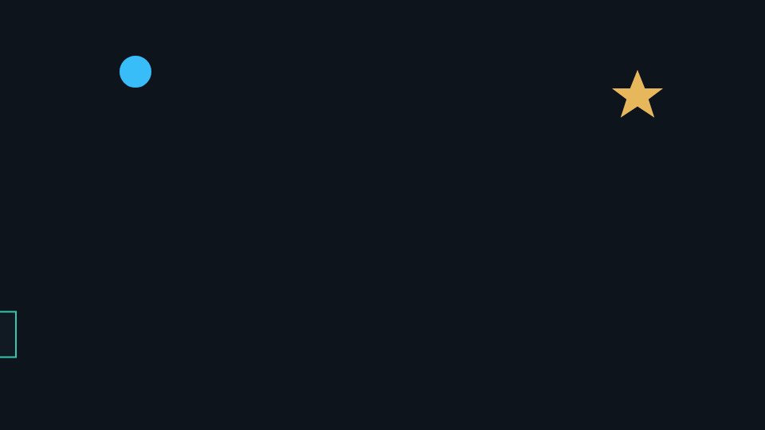
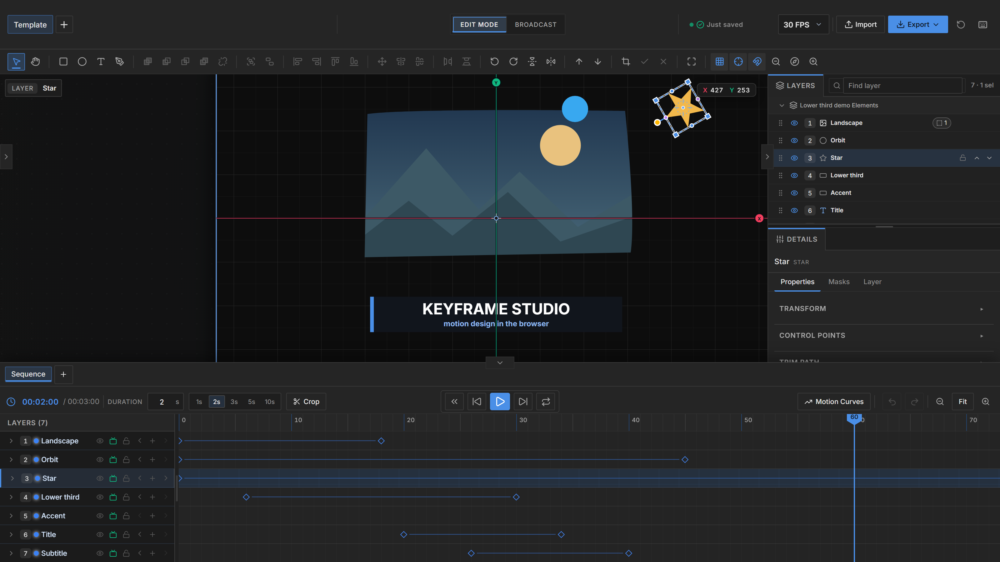
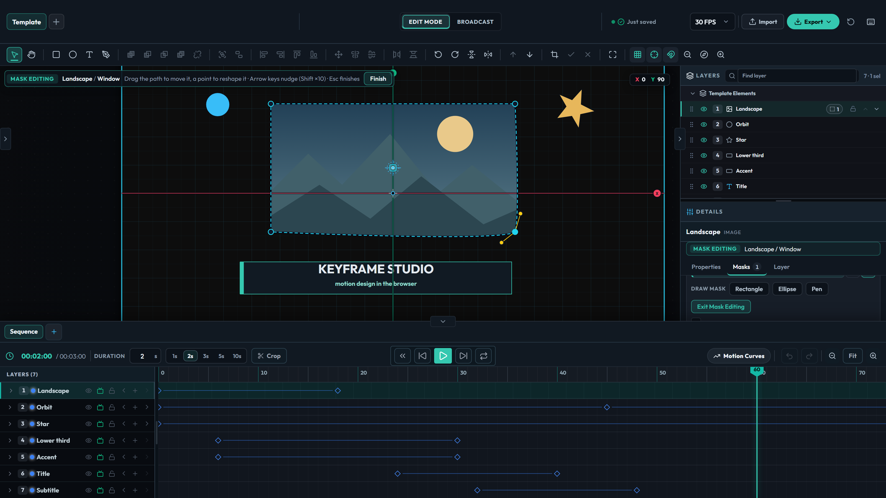
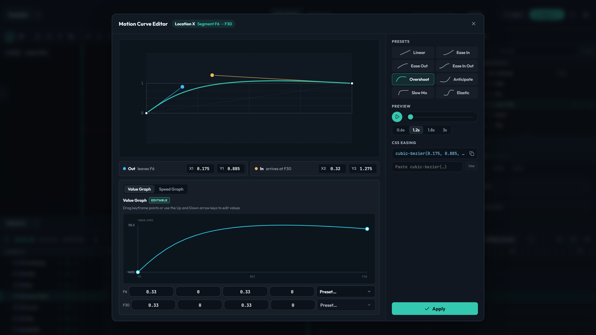
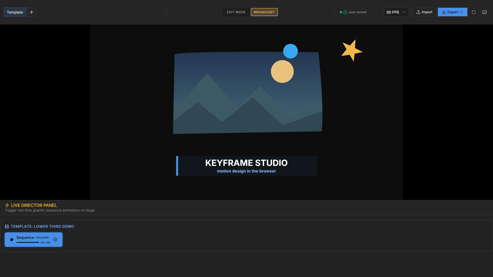
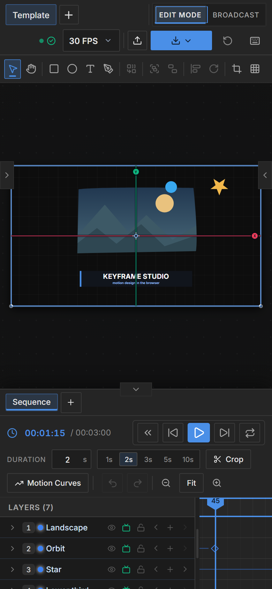
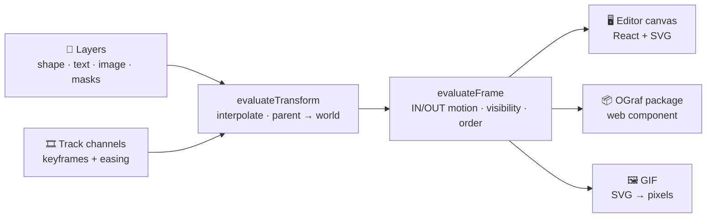
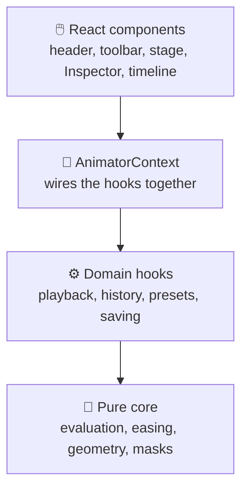
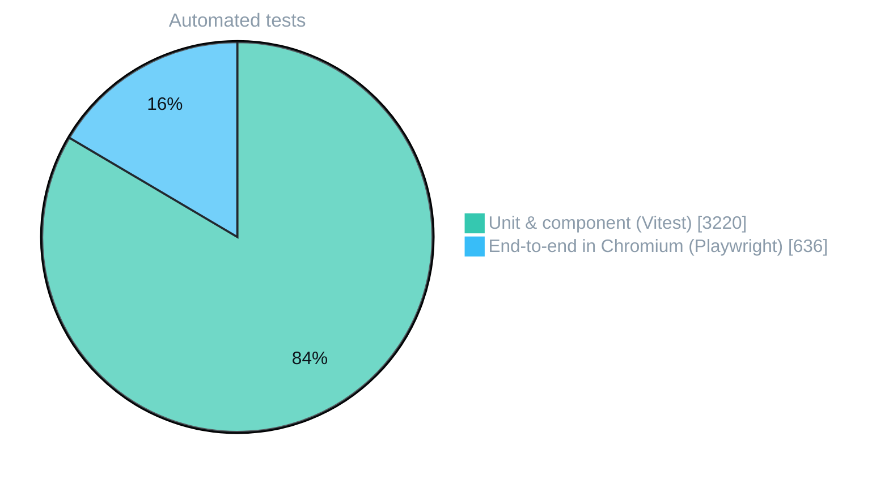
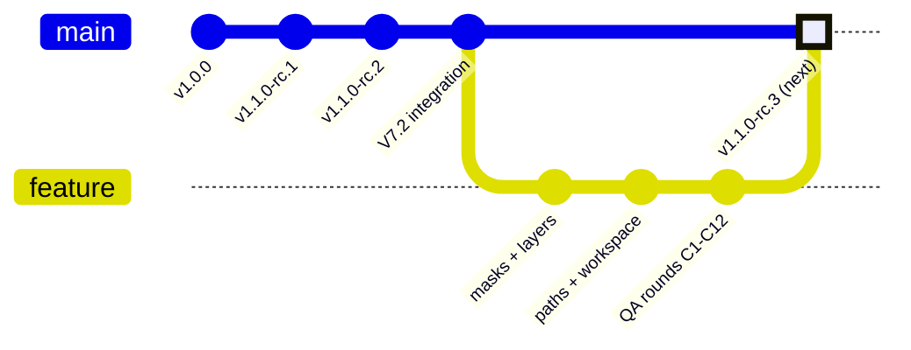

<div align="center">

# 🎬 Keyframe Character Studio

**A 2D keyframe and motion-design editor that runs in the browser.**
Draw, mask and animate vector scenes, then export them as broadcast graphics (OGraf), animated GIFs or project files.

[](CHANGELOG.md)
[](https://react.dev/)
[](https://www.typescriptlang.org/)
[](https://vitejs.dev/)
[](#-how-it-works)
[](#-quality)
[](#-quality)
[](LICENSE)



<sub>☝️ Made in KCS and exported with its own GIF encoder.</sub>

</div>

---

## ✨ What you can do

| | | |
|:---:|:---:|:---:|
| 🎞️ **Keyframe animation**<br><sub>Position, rotation, scale, opacity, Trim Path; bezier easing per segment</sub> | 🎭 **Masks & Track Matte**<br><sub>Draw masks on the canvas, cut holes, use any layer as a matte</sub> | ✏️ **Vector paths**<br><sub>Pen tool, editable paths, corner ↔ smooth points with handles</sub> |
| 📈 **Motion curves**<br><sub>Curve editor, value and speed graphs, presets, paste CSS easing</sub> | 🧩 **Layers & groups**<br><sub>Parenting, locks, Boolean operations, bonds between layers</sub> | 📡 **Broadcast mode**<br><sub>A live director panel that plays sequences with IN/OUT motion</sub> |
| 📦 **OGraf export**<br><sub>Web-standard broadcast graphics packages, checked per layer first</sub> | 🖼️ **Animated GIF**<br><sub>Frame-exact export with a built-in encoder</sub> | 📱 **Any screen**<br><sub>Desktop, half-screen windows, tablets and phones</sub> |

## 📸 A look inside

<table>
<tr>
<td width="50%"><br><sub><b>The editor</b>: stage, layer list, Inspector and a timeline with keyframes.</sub></td>
<td width="50%"><br><sub><b>Masks</b>: edited right on the canvas, with bezier handles.</sub></td>
</tr>
<tr>
<td><br><sub><b>Motion Curve Editor</b>: drag the handles or pick a preset.</sub></td>
<td><br><sub><b>Broadcast mode</b>: play sequences live from the director panel.</sub></td>
</tr>
</table>

<p align="center"><br><sub>📱 The same editor on a phone.</sub></p>

## 🧠 How it works

Everything you see on the stage is **SVG**. A frame is computed by a pure function: the same scene and frame always give the same picture. The editor, the OGraf package and the GIF exporter all draw from that one result.



The code is layered: a React-free core does the maths, hooks own the editor's domains, and React only shows and edits.



| Question | Answer |
|---|---|
| 🎨 **Why SVG?** | Sharp vectors at any zoom; native masks, clip paths and filters; hit-testing through the DOM; the same markup for export. |
| ⏱️ **Playback** | One `requestAnimationFrame` loop owns the playhead. Broadcast mode has its own engine and uses the same evaluation. |
| ↩️ **Undo** | Snapshots of layers and tracks; one user action is one step, and a drag is one step. |
| 💾 **Saving** | Autosave to the browser, guarded across tabs. Projects import and export as JSON and are fully validated first. |

## 🚀 Quick start

```bash
git clone https://github.com/ErtugrulAK/keyframe-character-studio.git
cd keyframe-character-studio
npm install
npm run dev:frontend      # editor only → http://localhost:5173
```

<details>
<summary>More commands</summary>

| Command | What it does |
|---|---|
| `npm run dev` | Editor plus the optional Express API (SQLite by default) |
| `npm run build` | Type-check and production build |
| `npm run check` | Lint, type check, unit tests and build |
| `npx vitest run` | Unit and component tests |
| `npm run test:e2e` | Playwright end-to-end tests in Chromium |
| `npm run validate:ograf` | Validate the OGraf fixture offline |

Requires Node.js `^22.22.2 || ^24.15.0 || >=26.0.0`. The editor runs entirely in the browser; the API in `server/` (projects and presets, SQLite or PostgreSQL) is optional.
</details>

## 🧪 Quality



- 🔍 Visual fixes are **measured** (pixel samples, element boxes), and new regression tests are checked against the old code.
- 🚫 A test is never relaxed to hide a bug.
- 📏 Masks, mattes and stroke alignment have DOM- and pixel-level regression tests.
- 📱 The layout is checked at 12 window sizes, from 320 px phones to 1366 px laptops.

## 🗺️ Releases



Versions follow [Semantic Versioning](https://semver.org/). Each candidate is QA'd by hand, and the accepted one becomes the final release. See [CHANGELOG.md](CHANGELOG.md) and [docs/RELEASING.md](docs/RELEASING.md).

## 🧭 Project status

KCS is an **independent prototype** built from scratch during an internship. It explores how much 2D motion design can be done in a lightweight browser workflow before reaching for heavier real-time graphics tools.

> It is **not** Zero Density production code, a Reality replacement, an Unreal Engine plug-in or a finished commercial integration.

## 🤝 Contributing · 🛡️ Security · 📄 License

- 🤝 [Contributing guide](CONTRIBUTING.md) and [Code of Conduct](CODE_OF_CONDUCT.md)
- 🛡️ [Security policy](SECURITY.md): please report vulnerabilities privately
- 📄 [MIT License](LICENSE) © 2026 ErtugrulAK
