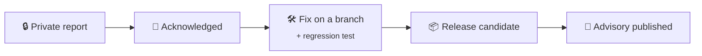

# 🛡️ Security Policy

## 📦 Supported versions

| Version | Supported |
|---|:---:|
| `main` and the latest `1.1.0` release candidate | ✅ |
| Earlier `1.1.0` candidates (`rc.1`, `rc.2`) | ⚠️ upgrade to the latest |
| `1.0.x` | ❌ |

## 🔒 Reporting a vulnerability

**Please don't open a public issue.**

1. Go to the repository's **Security** tab and choose **"Report a vulnerability"** (GitHub private vulnerability reporting).
2. Describe:
   - what you found;
   - how to reproduce it;
   - what it affects (editor import, OGraf package, GIF export, the optional API …);
   - a proof of concept, if you have one.
3. You will get an answer as soon as possible, usually within a week. A fix is planned according to severity.

## 🧱 What is protected today

| Area | Protection |
|---|---|
| 📥 **Imports** (project JSON, Lottie, OGraf) | The whole file is validated before anything changes. Prototype-sensitive keys are refused. |
| 🗜️ **OGraf ZIP** | Decoded in memory with entry-count and entry-size limits. Unsafe, duplicate or reserved paths are refused. |
| 🖼️ **SVG input** | Bounded and sanitised at the import boundary. |
| 💾 **Saved data** | Lives in the user's own browser storage. Concurrent tabs cannot overwrite each other's autosave. |
| 🌐 **Optional API** (`server/`) | Parameterised SQL, an explicit CORS allow-list, body-size limits. Secrets stay in `.env`, never in Git. |
| 📦 **Dependencies** | `npm audit` is part of the release check. |

> KCS is a prototype. The optional API is meant for trusted local use, not for hostile multi-tenant hosting.
